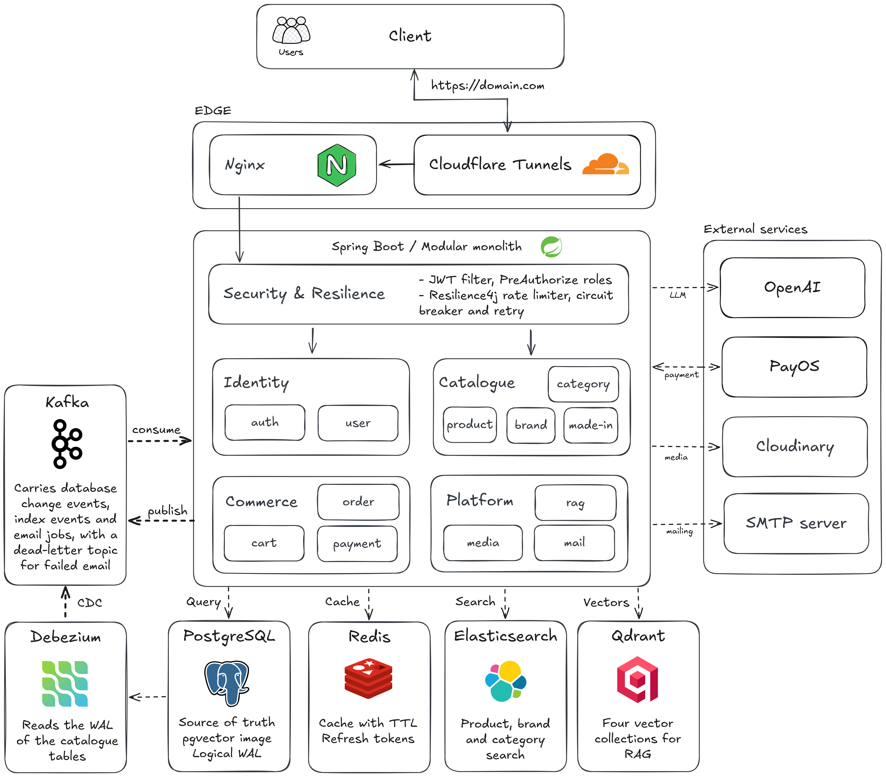
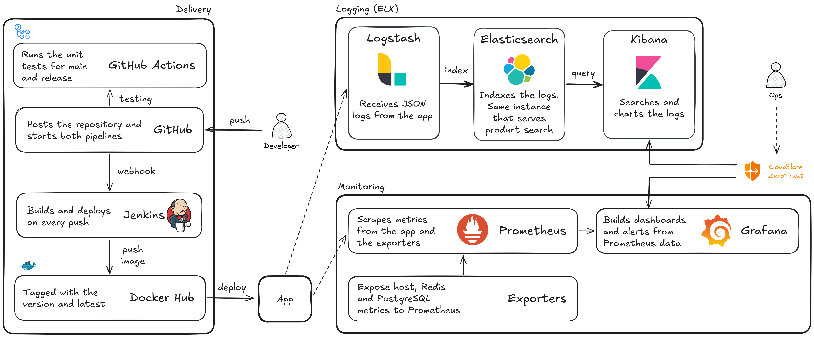

An e-commerce backend for a perfume shop, with change data capture, full-text search and an AI shopping assistant.

[API docs](docs/modules) ·
[Postman collection](postman/per-api-collection.json) ·
[Knowledge base](knowledge)

[](https://github.com/nguyenminh1301/e-commerce-platform/actions/workflows/test.yml)

## About

Per is the backend of an online perfume store. Shoppers register, browse products by brand,
category and country of origin, search the catalogue, fill a cart and pay through PayOS.
Each product carries perfume details such as fragrance family, sillage, longevity and
seasonality. A built-in assistant answers questions like "a fresh scent for summer" by
searching the catalogue and the shop's own guides, then asking an OpenAI model to reply with
product recommendations. Administrators manage the catalogue, images, users and the
assistant's knowledge base through the same API.

The whole backend is one Spring Boot application (a modular monolith) built with Java 21. The
API lives under `/per`.

## Architecture

### How a request flows through the system

[](docs/asset/runtime.png)

In production the application ran on a single VPS. Requests reached it through a Cloudflare
Tunnel and Nginx, then passed the security layer: a JWT filter, role checks on admin
endpoints, and Resilience4j rate limits, circuit breakers and retries. All of this runs
inside the application; there is no separate API gateway.

The thirteen modules fall into four groups:

| Group | Modules |
|-------|---------|
| Identity | `auth`, `user` |
| Catalogue | `product`, `brand`, `category`, `made-in` |
| Commerce | `cart`, `order`, `payment` |
| Platform | `media`, `mail`, `rag` |

PostgreSQL is the system of record. The other stores are derived from it:

| Store | Holds |
|-------|-------|
| PostgreSQL 16 | All business data, migrated by Flyway; runs with logical WAL for Debezium |
| Redis 7 | Cached catalogue lookups and refresh tokens |
| Elasticsearch 7.17 | Full-text search over products, brands and categories |
| Qdrant | Embeddings for the AI assistant, in four collections |

Changes reach the search index and the assistant through Kafka. Debezium reads PostgreSQL's
write-ahead log for the catalogue tables and publishes each change. The application also
publishes its own index events and email jobs. Kafka consumers inside the application then
update Elasticsearch and Qdrant, or send the email. A failed email goes to a dead-letter topic.

Checkout locks each product variant row before it deducts stock, so two shoppers cannot buy
the same last unit. The order then waits for payment. PayOS reports the result by webhook,
and the order becomes paid or is cancelled with its stock returned; a scheduler also cancels
payments that expire.

The application also calls four external services: OpenAI for embeddings and answers, PayOS
for payments, Cloudinary for product and brand images, and an SMTP server for welcome and
password-reset email.

### How code reaches production and how it is watched

[](docs/asset/ops.png)

Every push and pull request to `main` or `release` runs the unit tests in GitHub Actions.
Every push also triggers Jenkins, which builds the application inside a multi-stage Docker
build, pushes the image to Docker Hub as `nguyenminh1301/per` (tagged with the project version
and `latest`), and restarts the stack on the VPS with Docker Compose.

The application sends JSON logs over TCP to Logstash, which indexes them into Elasticsearch
(the same instance that serves product search) for Kibana. Prometheus scrapes
`/actuator/prometheus` and the host, Redis and PostgreSQL exporters, and Grafana builds
dashboards and alerts on top. In production, the team reached Kibana and Grafana through a
Cloudflare Zero Trust subdomain.

### How the AI assistant answers

[](docs/asset/rag.png)

The assistant uses retrieval-augmented generation. Two pipelines fill Qdrant:

- Catalogue changes arrive through Debezium and Kafka. Each changed product, brand or category
  is flattened to text, embedded with OpenAI and written to its collection.
- The markdown files in [`knowledge/`](knowledge) (policies, customer-service guide, fragrance
  guide) are split into 3,200-character chunks with 400 characters of overlap, embedded and
  stored in `knowledge_vectors`. This runs at startup when the collection is empty, or when an
  administrator calls `POST /per/rag/index/knowledge`.

A question sent to `POST /per/rag/chat` is embedded with the same model and matched against all
four collections, keeping the top 3 results from each that score 0.3 or higher. The hits are
merged into one context block and placed in a prompt with the system instructions from
`knowledge/system-prompt.txt`, the question and the expected JSON format. The OpenAI chat
model writes the answer; the application cleans and parses it, and falls back to a canned
answer if the JSON is unusable. The reply contains a summary, a detailed answer, recommended
products and next steps. `GET /per/rag/chat/stream` returns the same answer as plain-text
server-sent events.

## Tech stack

| Area | Technology |
|------|------------|
| Application | Java 21, Spring Boot 3.5, Spring Security with JWT, Spring Data JPA, Flyway, MapStruct, Resilience4j |
| AI | Spring AI 1.0 (milestone), OpenAI models, Qdrant |
| Messaging and CDC | Kafka (Confluent 7.6), Debezium 2.5 |
| Data | PostgreSQL 16 with pgvector, Redis 7, Elasticsearch 7.17 |
| External services | PayOS, Cloudinary, SMTP |
| Delivery | GitHub Actions, Jenkins, Docker, Docker Hub, Docker Compose |
| Observability | Logstash, Elasticsearch, Kibana, Prometheus, Grafana, node, Redis and PostgreSQL exporters |
| Testing | JUnit 5 with Spring Boot Test, JaCoCo |

## Documentation

| Document | Covers |
|----------|--------|
| [`docs/modules/`](docs/modules) | One guide per module: auth, user, product, cart, order, payment, media, rag and common |
| [`docs/kafka/`](docs/kafka) | Topics and events, retries and the dead-letter queue |
| [`docs/elasticsearch/`](docs/elasticsearch) | Indexing strategy, re-indexing and queries |
| [`docs/cache/`](docs/cache) | Redis cache configuration and the token blacklist |
| [`docs/resilience-patterns/`](docs/resilience-patterns) | Rate limiting and circuit breakers |
| [`postman/per-api-collection.json`](postman/per-api-collection.json) | Every endpoint, ready to import into Postman |

## Quick start

Requirements:

- Java 21
- Docker Desktop

1. Clone the repository:

   ```bash
   git clone https://github.com/nguyenminh1301/e-commerce-platform.git
   cd e-commerce-platform
   ```

2. Create `.env` from the example and fill it in. The application reads this file on
   startup, and Docker Compose uses it for the containers.

   ```bash
   cp .env.example .env
   ```

   The example points at container host names (`postgres`, `redis`, `kafka`, `qdrant`,
   `elasticsearch`). When you run the application on your own machine, as in step 4, point
   it at the published ports instead:

   ```dotenv
   POSTGRES_URL=jdbc:postgresql://localhost:5432/postgres
   REDIS_HOST=localhost
   QDRANT_HOST=localhost
   KAFKA_BOOTSTRAP_SERVERS=localhost:29092
   ELASTICSEARCH_URI=http://localhost:9200
   ```

   > Important: the AI assistant needs `OPENAI_API_KEY`, `OPENAI_CHAT_MODEL` and
   > `OPENAI_EMBEDDING_MODEL`. Payments, image uploads and email need the PayOS, Cloudinary
   > and SMTP credentials.

3. Start the infrastructure:

   ```bash
   docker compose up -d
   ```

   This starts PostgreSQL, Redis, Kafka, Debezium, Elasticsearch, Logstash, Kibana, Qdrant,
   Prometheus, Grafana, the metric exporters and the Kafka and Debezium web consoles. The
   Debezium connector registers itself once Kafka Connect is up.

4. Run the application:

   ```bash
   ./mvnw spring-boot:run
   ```

   Or `make run`, which checks that Java, Docker and `.env` are present, starts the
   containers and then the application. On first start, Flyway creates the schema and loads
   demo data, and the assistant indexes the catalogue and the knowledge base into Qdrant.

The API listens on `http://localhost:8080/per`. With the default `dev` profile, Swagger UI is
at `http://localhost:8080/per/api-docs`.

### Local consoles

| Tool | Address |
|------|---------|
| Kafka UI | `http://localhost:8090` |
| Debezium UI | `http://localhost:8084` |
| Kibana | `http://localhost:5601` |
| Grafana | `http://localhost:3000` |
| Prometheus | `http://localhost:9091` |
| Qdrant | `http://localhost:6333/dashboard` |

### Running the tests

```bash
./mvnw clean test
```

## License

Released under the [MIT License](LICENSE).
